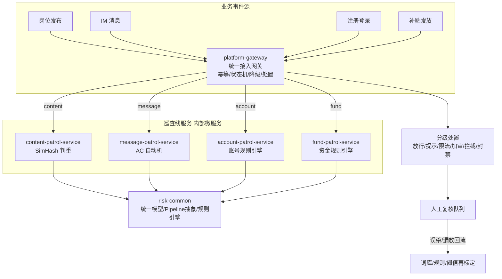

# Risk Control Platform · 风控平台

> 蓝领招聘平台的**统一风控中台**。不再按"巡查线"拆仓：平台只有一个，巡查只是内部功能。
> 本仓库为微服务 Monorepo：**一个统一接入网关 + 四条巡查线服务 + 一个共享风控底座**，
> 每个服务独立构建镜像、独立部署（Dockerfile + K8s 配置齐备）。
>
> **定位：架构演示仓库** —— 用于展示业务建模、服务拆分与部署形态，不含 CI/CD 流水线。

## 1. 业务全景

平台治理四类业务风险，对应四条内部巡查线：

| 巡查线 | 微服务 | 风险场景 | 核心技术 | 决策方式 |
|---|---|---|---|---|
| 内容巡查 | `content-patrol-service` | 黑中介洗稿岗位、信息流重复 | SimHash + 3-gram + 抽屉原理分段索引 | 双通道判重（正文 SimHash 主通道 + 标题编辑距离兜底） |
| 消息巡查 | `message-patrol-service` | 飞单/私单诱导话术 | AC 自动机 + 三步变体归一化 + 角色分级 | 白名单降级 + 招聘侧拦/求职侧提示 |
| 账号巡查 | `account-patrol-service` | 接码注册、设备农场养号 | 号段特征 + 设备/IP 聚集 + 行为序列 | 规则引擎（6 条分级规则） |
| 资金巡查 | `fund-patrol-service` | 补贴薅取、领补贴团伙 | 放款前后分层 + 设备/银行卡聚集 | 规则引擎（4 条分层规则） |

`platform-gateway` 是所有风险的**唯一入口**，承担共同基建：事件路由、消费幂等（`event_id+version`）、
状态机单调前进、分级处置、巡查线降级（不可用转人工加审，绝不漏审）。

`risk-common` 是共享底座：统一决策模型（`Decision`/`PatrolVerdict`）、同构 Pipeline 抽象
（归一化 → 特征提取 → 检测 → 决策）、轻量规则引擎（优先级短路 + 不可变快照）。

## 2. 架构



## 3. 统一契约

平台只有一个巡查契约，新增巡查线 = 新增一个服务 + 注册一条路由，不动任何基建：

```
POST /api/v1/patrol/dispatch          # 网关唯一入口
{
  "eventId": "job:123",               # 幂等键
  "domain":  "content",               # 巡查线路由键: content/message/account/fund
  "version": 1,                       # 事件版本（重放拒绝旧版本）
  "payload": { ...巡查线业务字段... }
}
→ { "accepted": true, "verdict": {...}, "disposition": {"action": "BLOCK"}, ... }
```

每个巡查线服务暴露统一检测接口 `POST /api/v1/patrol/check`（payload 即请求体），返回统一
`PatrolVerdict { eventId, decision, score, reason, detail }`。

**决策枚举（全平台统一）**：`PASS → WARN → LIMIT → EXTRA_REVIEW → INTERCEPT → BAN`
（状态机只允许沿此序单调前进，回跳拒绝）。

## 4. 巡查线业务规则速览

**内容巡查**：城市+工种分片前置（跨城市同模板合法）→ SimHash 汉明距离 ≤3 判重 → 标题编辑距离 ≤4 兜底；判重即拦截。

**消息巡查**：符号归一（➕→加/❤→信）→ 干扰符剔除（破解"加.薇.芯"）→ 变体映射（vx/薇芯→微信）→ AC 自动机一次扫描；招聘侧命中拦截、求职侧仅提示、官方话术白名单放行。

**账号巡查**：虚拟号段+设备聚集 → 封禁；同设备≥5 账号 → 封禁；同 IP 24h 注册≥10 → 拦截；虚拟号段单独命中 → 加审；夜间批量注册 → 加审；24h 发帖≥20 → 限流。

**资金巡查**：同银行卡≥3 账号 → 封禁（团伙）；同设备≥3 账号且金额≥500 → 拦截；新号（≤3 天）高额（≥200）→ 加审（放款前分层）；24h 申请≥5 → 限流。

## 5. 快速开始

### 本地构建与测试

```bash
mvn verify          # JDK 17，全模块测试
```

### 本地起服务体验全链路

```bash
mvn -pl content-patrol-service spring-boot:run &
mvn -pl message-patrol-service spring-boot:run &
mvn -pl account-patrol-service   spring-boot:run &
mvn -pl fund-patrol-service      spring-boot:run &
mvn -pl platform-gateway        spring-boot:run &

# 统一入口分发一次岗位巡查事件
curl -X POST http://localhost:8080/api/v1/patrol/dispatch \
  -H 'Content-Type: application/json' \
  -d '{"eventId":"job:1","domain":"content","version":1,
       "payload":{"jobId":1,"city":"重庆","trade":"钢筋工","title":"急招钢筋工30名包吃住",
                  "body":"急招钢筋工30名，包吃包住，日结260，工头王师傅13900000000"}}'
```

### 构建镜像（每个服务一个 Dockerfile，构建上下文 = 仓库根）

```bash
docker build -f platform-gateway/Dockerfile        -t risk/platform-gateway:1.0.0 .
docker build -f content-patrol-service/Dockerfile  -t risk/content-patrol-service:1.0.0 .
docker build -f message-patrol-service/Dockerfile  -t risk/message-patrol-service:1.0.0 .
docker build -f account-patrol-service/Dockerfile  -t risk/account-patrol-service:1.0.0 .
docker build -f fund-patrol-service/Dockerfile     -t risk/fund-patrol-service:1.0.0 .
```

### 部署到 K8s

```bash
# 方式一：kustomize 一键部署（namespace: risk-control）
kubectl apply -k deploy/k8s

# 方式二：逐个 apply
kubectl apply -f deploy/k8s/
```

镜像仓库地址默认 `registry.example.com/risk/*`，替换为你的仓库（改各 Deployment 的 image 或 kustomization.yaml 的 images 段）。
网关经环境变量把巡查线路由指向集群内 Service DNS（`http://content-patrol-service:8081` 等）。

## 6. 目录结构

```
risk-control-platform/
├── AGENTS.md                   # Agent 协作总纲（裁剪自 agent-workflow-specs，含不适用清单）
├── pom.xml                     # 父 POM（Spring Boot 3.3 BOM + 模块管理）
├── risk-common/                # 风控底座：统一模型 / Pipeline 抽象 / 规则引擎
├── platform-gateway/           # 统一接入网关 (8080)：幂等/状态机/路由/处置/降级
├── content-patrol-service/     # 内容巡查线 (8081)：岗位真实性 SimHash 判重
├── message-patrol-service/     # 消息巡查线 (8082)：飞单/私单 AC 自动机治理
├── account-patrol-service/     # 账号巡查线 (8083)：接码/养号治理
├── fund-patrol-service/        # 资金巡查线 (8084)：补贴薅取治理
├── deploy/
│   ├── docker/                 # （Dockerfile 分布在各模块根，构建上下文为仓库根）
│   ├── k8s/                    # namespace/configmap/deployment/service/HPA/ingress/kustomize
│   └── sql/                    # 生产化 MySQL 表结构（基建/消息线/内容线）
```

> demo 仓库：不含 CI/CD 流水线，构建与部署均为手工执行。
> Agent 协作约定（worktree 隔离、契约先行、轨道分档、验收证据口径、不适用清单）见 `AGENTS.md`。

## 7. 生产化演进路线

- [ ] 幂等/状态机从进程内 Map 落到 MySQL（表结构已备：`deploy/sql/common-schema.sql`）
- [ ] 接入层从同步 HTTP 演进为 Kafka 事件总线（网关契约不变，巡查线消费各自 topic）
- [ ] 规则/词库管理端 + 热更新（规则快照原子切换，`patrol_rule` 表已备）
- [ ] 人工复核工作台 + 误杀/漏放标注回流（词库、阈值月度重标定）
- [ ] 巡查指标大盘（桶倾斜/堆积/命中率/误杀率）
- [ ] OpenTelemetry 全链路追踪（eventId 贯穿网关与巡查线）
